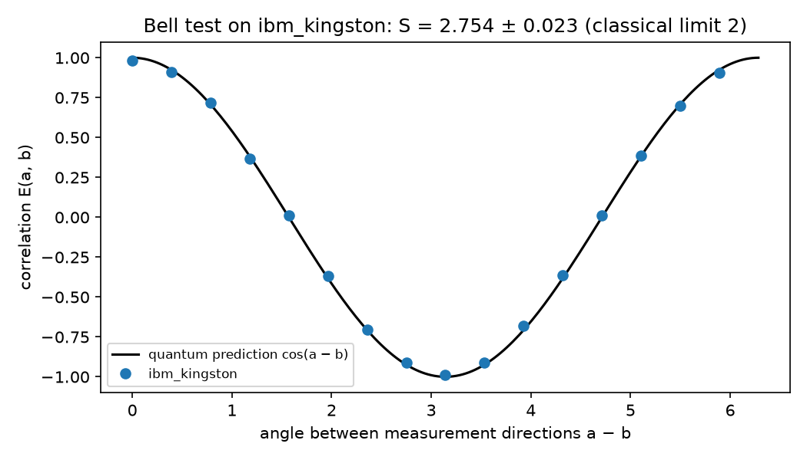
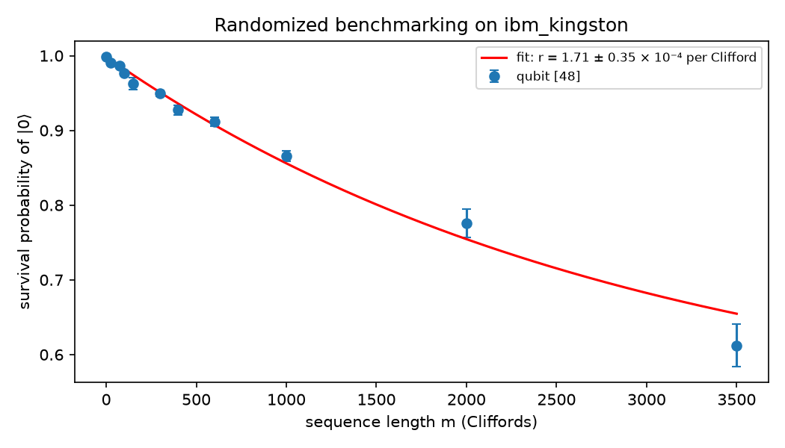
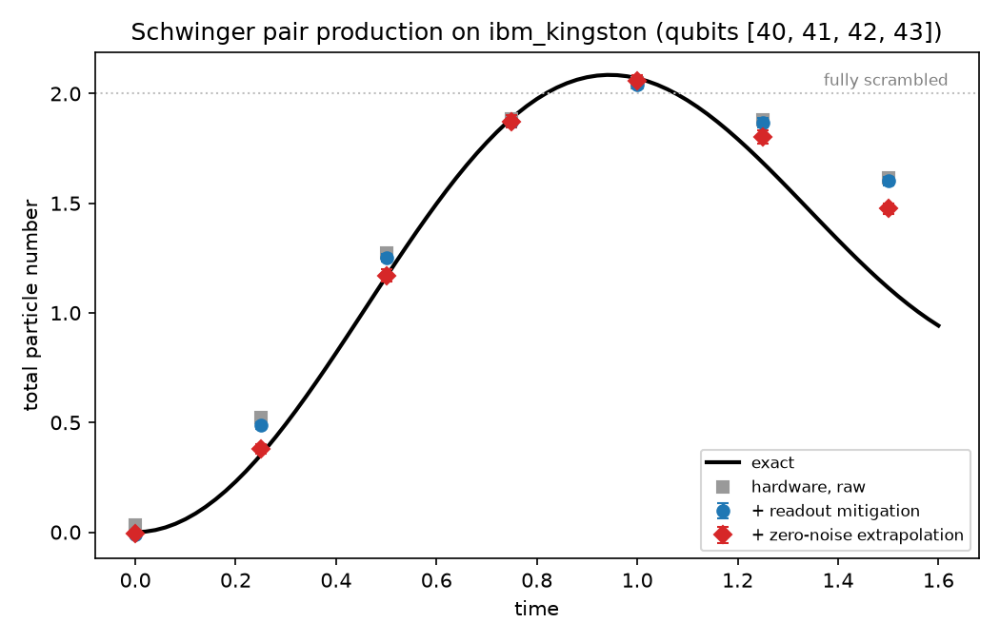

# Runs on real quantum hardware

Three experiments ran on **ibm_kingston**, an IBM Heron r2 processor with 156 superconducting
qubits, on 13 October 2026. They used 122 seconds of quantum time on the free Open plan. Raw counts,
job ids, the qubits used and every analysis step are in this folder, so each number below can be
recomputed.

| Experiment | Result | Ideal |
|---|---|---|
| Bell test (CHSH), qubits 149 and 148 | **S = 2.754 ± 0.023** | 2√2 ≈ 2.828; any classical model ≤ 2 |
| Randomized benchmarking, qubit 48 | **error per Clifford (1.71 ± 0.35) × 10⁻⁴** (average gate fidelity 99.983%) | |
| Schwinger pair production, 4 sites, qubits 40–43 | matches the exact curve within errors up to t = 1 after mitigation (table below) | exact diagonalisation |

## Bell test



A Bell pair, with Bob's measurement direction swept through 16 angles and the four CHSH settings
(4000 shots each). The correlations follow cos(a − b), and S violates the classical bound by
33 standard deviations. A chip is not a loophole-free Bell test, since the qubits are millimetres
apart; it shows how close real entangled qubits get to the quantum limit.

## Randomized benchmarking



Random sequences of single-qubit Cliffords followed by their inverse, 8 sequences per length,
lengths 1 to 3500, in two runs (500 shots per sequence). The fit A f^m + B, with A and B bounded
to [0, 1] and weighted by the standard error of each length, gives f = 0.99966 ± 0.00007,
A = 0.49 and B = 0.51.

The first run only reached 600 Cliffords; with the survival still at 0.91, a free fit could not
separate f from B (it returned B = 0.85). The second run extended the lengths to 3500. Both runs
are kept and combined.

## Schwinger pair production



The 4-site lattice Schwinger model (x = 1, m = 0.5, g = 0.6, Martinez et al. 2016), quenched from
the bare vacuum. It uses second-order Trotter steps of 0.25, so up to 158 CZ gates at t = 1.5,
with 4000 shots per circuit. Two corrections are applied:

1. **Readout**: the confusion matrix of each qubit is measured on |0000⟩ and |1111⟩ and inverted.
2. **Zero-noise extrapolation**: every CZ is folded to CZ·CZ·CZ (fully for 3×, half of them for 2×)
   *after* compilation, so the compiler cannot cancel the folding. The three results are then
   extrapolated linearly to zero noise.

Error bars come from a bootstrap over the shots (200 resamples, calibration circuits included).

| t | exact | raw | readout mitigated | + zero-noise extrapolation |
|---|---|---|---|---|
| 0 | 0.000 | 0.031 | −0.011 ± 0.004 | −0.008 ± 0.005 |
| 0.25 | 0.352 | 0.521 | 0.486 ± 0.014 | 0.379 ± 0.022 |
| 0.5 | 1.165 | 1.275 | 1.252 ± 0.018 | 1.170 ± 0.027 |
| 0.75 | 1.888 | 1.884 | 1.871 ± 0.018 | 1.873 ± 0.028 |
| 1 | 2.070 | 2.050 | 2.041 ± 0.019 | 2.057 ± 0.028 |
| 1.25 | 1.685 | 1.878 | 1.867 ± 0.020 | 1.803 ± 0.030 |
| 1.5 | 1.115 | 1.615 | 1.601 ± 0.018 | 1.475 ± 0.026 |

Up to t = 1 the mitigated hardware agrees with the exact answer. Beyond it, even the unfolded
circuits are close to fully scrambled (2 particles on average), and extrapolation cannot recover the
signal.

**All three runs are reported, not just the best one:**

- **Run 1** (`schwinger-run1-*`): the compiler placed the circuit on qubits 0–3. Two of those had
  readout errors of 57% and 37% at the time. Mitigation still recovered sensible values, but the
  qubits are now chosen explicitly from the current calibration (`best_qubits` in `run.py`).
- **Run 2** (`schwinger-run2-*`, the one above): noise scales 1×, 2×, 3× on qubits 40–43.
- **Run 3** (`schwinger-run3-*`): gentler scales 1×, 1.3×, 1.6×. The differences between scales
  were then smaller than the shot noise, and extrapolation amplified noise instead of removing bias.

## Reproduce

```bash
python hardware_runs/run.py simulate chsh|schwinger|rb   # free: Aer with the device's noise model
python hardware_runs/run.py submit   chsh|schwinger|rb   # needs a saved IBM Quantum account
python hardware_runs/run.py fetch    chsh|schwinger|rb
python hardware_runs/analyze.py      chsh|schwinger|rb ibm_kingston
python hardware_runs/plot.py
python hardware_runs/export_web.py   # the numbers shown on the website
```

The account key is saved with `QiskitRuntimeService.save_account(...)` in the user's home folder
and never enters this repository. `tests/test_hardware_runs.py` checks the folding and that the
stored analyses follow from the raw counts; `web/tests/hardware.test.js` checks the website's
copy of the numbers.
